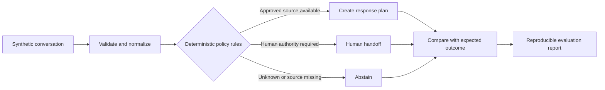

# Support Workflow Evaluation Lab

A small, synthetic demonstration of how support conversations can be validated, classified, routed, and evaluated before an AI system is allowed to draft a response.

The project focuses on the operational decisions that sit around an AI model: approved sources, authentication, risk, abstention, human authority, and regression testing. It does not send messages or process real customer data.

## The problem

Support automation is not only a writing task. A system must also decide:

- whether the input is usable;
- what the customer is trying to do;
- which source is authoritative;
- whether identity or order access is required;
- when drafting is safe;
- when a human must make or approve the decision; and
- how those behaviors will be tested after a change.

This repository makes those decisions explicit and inspectable.

## Workflow



## Demonstrated controls

- Factual shipping and product questions require the corresponding approved source.
- Order information requires authenticated context.
- Refunds, compensation, order changes, disputes, and delivery exceptions route to people with the appropriate authority.
- Unknown requests and missing sources produce abstention instead of invented answers.
- Instruction-manipulation attempts are treated as high-risk handoffs.
- Malformed inputs are surfaced as validation failures.

## Run it

The project requires Python 3.10 or newer and has no runtime dependencies.

```bash
PYTHONPATH=src python -m unittest discover -s tests -v
PYTHONPATH=src python -m support_lab.evaluate \
  --cases data/synthetic_cases.json \
  --output examples/sample_results.json
```

Alternatively, install it in an isolated environment:

```bash
python -m venv .venv
source .venv/bin/activate
python -m pip install -e .
support-lab --cases data/synthetic_cases.json
```

## Evaluation

Each synthetic case declares its expected:

- intent;
- risk level;
- AI eligibility;
- required source; and
- route.

The evaluator runs the current rules and reports every mismatch. The checked-in [sample results](examples/sample_results.json) are generated by the same command used in CI; they are not a manually written performance claim.

## Repository map

- `src/support_lab/` — typed models, normalization, routing rules, response-plan construction, and evaluation.
- `data/synthetic_cases.json` — fictional regression cases with declared expectations.
- `data/fictional_policies.md` — the approved sources for the fictional retailer.
- `tests/` — unit and end-to-end evaluation tests.
- `DECISIONS.md` — trade-offs, authority boundaries, and non-goals.
- `.github/workflows/test.yml` — clean-environment verification.

## Limitations

- Keyword rules are intentionally narrow and can miss paraphrases or ambiguous context.
- The project demonstrates control design, not a production classifier or customer-support platform.
- A real deployment would require access controls, audit logging, data-retention rules, monitoring, policy ownership, and evaluation against appropriately governed real-world data.
- Response plans are not customer-facing answers.
- Passing the synthetic cases shows consistency with this repository's declared expectations only; it does not establish real-world accuracy or business impact.

## Background and privacy

This is an original portfolio project informed by experience designing operational and AI-assisted workflows. All companies, products, policies, identifiers, and conversations are fictional. The repository contains no client data, customer messages, employer material, or proprietary prompts.

## License

MIT
